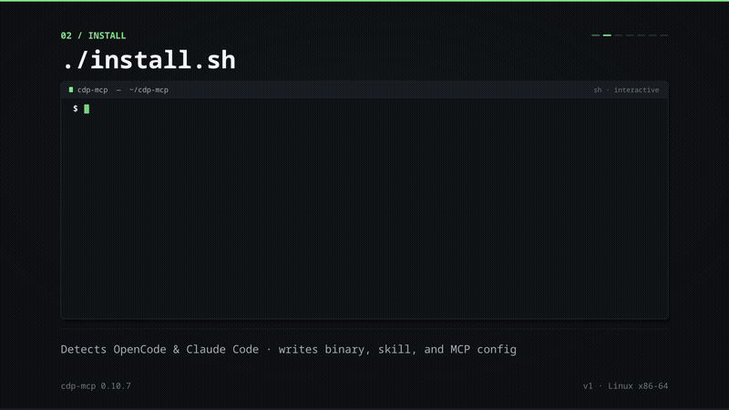

# cdp-mcp

A small MCP server that drives **your own** Chromium browser over the DevTools
protocol — plus a `cdp` CLI for the same tools when a shell command is cheaper
than a tool call.

No extension, no relay, no second browser. It attaches to the browser you already
use, so every login you have is already there when an agent starts working.

**One static musl binary, no async runtime, no network service of its own.**

---



A 33-second cut with the installer session and a synthesized sound bed is in
`video/`; rebuild it with `python3 video/build.py`.

## Why another browser MCP

Three decisions, each fixing something that made the alternatives unpleasant:

**It attaches to a running browser.** Playwright-style tools launch their own
Chromium with an empty profile, which means no logins — and a login is usually
the whole task. This connects to a browser you start normally.

**Real input events.** Clicks and keystrokes go through
`Input.dispatchMouseEvent` and `Input.insertText`, not `element.click()`. React,
Draft and anything contenteditable ignore synthetic DOM events; real events are
accepted because they *are* real events.

**References that cannot go stale.** `elements` returns every visible interactive
element with a label and a clickable centre. `input {click:{i}}` re-resolves that
index at click time — scrolling it into view, re-measuring, hit-testing what is
actually on top — so an old list can never click the wrong thing.

## Install

**From a release — no Rust, no checkout.** Needs `curl`, `tar` and `python3`:

```sh
curl -fsSL https://github.com/benkaesy820/cdp-mcp/releases/latest/download/install.sh -o /tmp/cdp-install.sh
bash /tmp/cdp-install.sh
```

It detects OpenCode, Claude Code and Codex, asks which should get the MCP entry
and the skill, then asks whether to install for every project or one. The
downloaded tarball is verified against the published `SHA256SUMS` before anything
is installed.

**From a checkout** (builds with Rust 1.88+):

```sh
git clone https://github.com/benkaesy820/cdp-mcp
cd cdp-mcp
./install.sh
```

Non-interactive: `./install.sh --global --yes --harness opencode,codex`.

**By hand:**

```sh
cargo install --git https://github.com/benkaesy820/cdp-mcp
```

Removal: `scripts/uninstall.sh` (binaries and harness entries) or
`scripts/uninstall.sh --purge` (that plus consent, skills, reports and state).

### What it writes

| Path | Purpose |
|---|---|
| `~/.local/bin/cdp-mcp` | the server |
| `~/.local/bin/cdp` | symlink, the CLI |
| `~/.local/bin/cdp-browser` | launcher: starts the first Chromium it finds on 9222, or a free port, and publishes it |
| `~/.config/cdp-mcp/consent.json` | whether a browser may be started, and which |
| `~/.config/opencode/skills/cdp-mcp/SKILL.md` | skill for OpenCode (and per-harness paths for Claude Code, Codex) |
| harness MCP config | the `cdp` server entry, backed up before editing |

## Requirements

A Chromium-family browser started with a DevTools port:

```sh
# Linux (Helium, Chrome, Chromium, Brave, Edge, Vivaldi…)
helium-browser --remote-debugging-port=9222
google-chrome --remote-debugging-port=9222

# macOS
/Applications/Google\ Chrome.app/Contents/MacOS/Google\ Chrome --remote-debugging-port=9222

# Windows
chrome.exe --remote-debugging-port=9222
```

`--remote-debugging-port=0` also works: the browser writes the chosen port to
`DevToolsActivePort` in its profile, and this server reads it. When neither 9222
nor a published port answers, `cdp-browser` gives it a free port and publishes it
in `$XDG_RUNTIME_DIR/helium-cdp.port`.

Recent Chrome builds **ignore the flag on the default profile**; give Chrome a
dedicated `--user-data-dir` if the port never opens. Helium is exempt in practice
(measured on 157: no `--user-data-dir`, port open). Firefox and Safari are not
supported — different protocol.

Any Chromium-family browser works; the tool speaks CDP, so it is not tied to one
vendor.

## Configure

Any MCP client that speaks stdio. OpenCode (`~/.config/opencode/opencode.json`):

```json
{
  "mcp": {
    "servers": {
      "cdp": {
        "type": "local",
        "command": ["/home/you/.local/bin/cdp-mcp", "--profile", "default"]
      }
    }
  }
}
```

Claude Code and Codex prefer their own CLIs, which the installer uses:

```sh
claude mcp add --scope user cdp -- ~/.local/bin/cdp-mcp --profile default
codex mcp add cdp -- ~/.local/bin/cdp-mcp --profile default
```

| Flag | Meaning |
|---|---|
| `--cdp URL` | endpoint, default `http://127.0.0.1:9222` |
| `--profile NAME` | settings file to read, default `default` |
| `--allow-remote` | permit a non-loopback endpoint (experimental build only) |
| `-h`, `--help` / `-V`, `--version` | |

### Consent and tabs

Starting a browser is a visible action on someone's desktop, so it is opt-in.
`cdp-mcp setup` asks once — may it start a browser, and which one — and writes
`~/.config/cdp-mcp/consent.json`. No file means no launch: `status` then answers
`up:false` with `launchAllowed`, `canLaunch` and a hint naming the command.

Nothing assumes a vendor: the launcher starts whichever Chromium-family
command is installed (Helium, Chromium, Chrome, Brave, Edge, Vivaldi), a
consented name that is missing falls back to the first one found, and
discovery reads whatever publishes a DevTools port — the browser is never
named in the code path that finds it.

The tab policy is a rule, not a question: **one tab, navigated in place**. New
tabs open in the background and never take the keyboard; bringing one to the front
is refused unless the consent file explicitly allows it.

### Tab handles

`status` and `tabs list` return `t1`, `t2`… beside each target id. Every tool
accepts a handle wherever a tab is named — it is 3 characters instead of 32 and it
is resolved before the handler sees it. The raw id still works. A handle that
names nothing is an error, not a pass-through.

## Tools

Fourteen. Each resolves its own tab, so nothing has to be called first.

| Tool | What it does |
|---|---|
| `status` | browser, protocol, every page tab with its handle; a doctor result (`up:false`, why, and whether launching is allowed) when CDP is down. `inUse:true` adds whether a page this server did not open has focus |
| `tabs` | `list` · `open {url}` (background) · `close` · `goto` · `back` · `forward` · `reload` |
| `elements` | visible interactive elements with `{i, tag, role, label, x, y}` — through shadow roots, same-origin and cross-origin frames; plus `overlays`, `media`, `scroll`, form state, `capped` and a `hint` |
| `text` | the page as readable text, top to bottom; `within` a selector, `limit` characters |
| `input` | real input in order, in one call: click, type, key, scroll, select, hover, drag, touch, dismiss, wait |
| `eval` | evaluate JavaScript in the page, return JSON, awaits promises |
| `flow` | run steps server-side and repeat until a condition holds — N acts for one turn |
| `idle` | wait with no polling: an element exists, text appears, or the page stops changing |
| `shot` | screenshot to a path (one line back), or inline when you ask for it |
| `paste` | type text or paste an image into the focused element |
| `upload` | set files on an `<input type=file>` |
| `download` | save a resource to a path, including cross-origin ones |
| `pdf` | render the page to a PDF file |
| `emulate` | device metrics, scale, touch and media state; `reset` restores the table |

Indexes are re-resolved at click time, so they cannot go stale between the scan
and the click. `within` scopes a scan to a subtree; `find` filters by label;
`limit` caps the list (default 120, scan cap 600, reported as `capped` with a hint
telling you how to narrow it).

### `input` actions

```json
[
  { "click": { "i": 7 } },                          // index from elements
  { "click": { "x": 400, "y": 320 } },              // or raw coordinates
  { "click": { "i": 3, "button": "right" } },        // right / middle, count:2, modifiers
  { "hover": { "i": 4 } },
  { "drag": { "from": { "i": 2 }, "to": { "x": 500 } }, "steps": 12 },
  { "tap": { "i": 5 } }, { "swipe": { "from": {}, "to": {} } },
  { "select": { "i": 6, "value": "two" } },
  { "insert": "text, typed like a keyboard" },
  { "key": "Control+a" },
  { "scroll": { "dy": 600 } },
  { "dismiss": { "prefer": "reject" } },
  { "wait": { "text": "Saved", "ms": 15000 } },
  { "sleep": { "ms": 300 } }
]
```

Indexed clicks are pre-flighted: a detached, zero-size, disabled or covered target
is refused with `{blocked, reason, obscuredBy}` unless `force` is true. If the
only obstruction is an **advertisement** — matched by its class, id, aria-label, an
ad-network iframe or Google-ads nodes — it is hidden, the point is re-tested, and
the click lands on the revealed target; dialogs, forms and anything unclassified
keep the refusal.

`settleMs` (default 0) reads CDP events after the actions and reports same-origin
HTTP errors, uncaught exceptions and console errors in `errors`, plus `navigated`,
`url` and `openedTab` when the click moved the page.

### Knowing a page is still loading

`elements` reports `nodes` (how many exist) and a `suspect` field. A scan that
finds almost no elements on a document with almost no nodes says *"page may still
be rendering"* instead of returning an empty list as fact.

`idle { untilSelector: "input[name=email]" }` is the matching wait: it returns the
moment that element exists.

### What it can see through

| Boundary | How |
|---|---|
| open shadow roots, including nested | walks every `shadowRoot` |
| same-origin iframes | walks `contentDocument` |
| cross-origin iframes | attaches to the frame's own target and reads it in its own session |

A cross-origin frame is only separate when it is a different **site** — two ports
on `127.0.0.1` are one site and stay in one renderer, which is a limit of site
isolation rather than of this tool.

### A typical flow, three calls

```jsonc
// 1. what is on the page
{ "name": "elements", "arguments": { "find": "save" } }

// 2. do several things at once
{ "name": "input", "arguments": { "actions": [
    { "click": { "i": 12 } },
    { "insert": "Hello" },
    { "key": "Enter" }
] } }

// 3. prove it worked
{ "name": "eval", "arguments": { "expression": "document.body.innerText.includes('Hello')" } }
```

## The `cdp` CLI

The MCP catalogue costs context on every turn (~18 KB of schema). A shell command
costs nothing to invoke, so the same tools are available as verbs:

```sh
cdp status                     # t1  Title  URL   (one line per tab, ~5 ms)
cdp read --max 800             # the page as text
cdp find "Save"                # i  label  x,y  tap|---
cdp click 3                    # act on that index
cdp go https://example.com     # navigate the current tab, in place
cdp shot --path /tmp/s.png     # one line: the path
cdp eval "document.title"
cdp json elements '{"find":"Save"}'   # escape hatch: any tool, raw arguments
```

`--tab t1|id`, `--json`, `--max N`, `--path P` after the verb. In the CLI a handle
is positional — `t1` is the first tab `status` lists, because each invocation is a
new process.

## Cost

Measured on the development machine (medians): `eval` ~2 ms, `status` ~5 ms, a
click ~17 ms, a full `elements` scan ~28 ms and ~8 KB of JSON instead of 1.5 MB of
HTML. The tool catalogue is ~18 KB of schema; the CLI exists so a long session can
avoid paying for it on every turn. `flow` runs a loop server-side, so a hundred
clicks cost one model turn; `idle` waits without spending one.

## Protocol

Dual-era. It answers the `initialize` handshake for clients on the 2025-06-18
revision and earlier, and implements the 2026-07-28 stateless surface as well:
`server/discover` advertising the supported versions, `resultType` on results, and
`ttlMs`/`cacheScope` on `tools/list` so a client may cache the catalogue. Tool
order is fixed, which keeps that cache key stable.

## Security

**CDP has no authentication.** Anything that can reach the port controls the
browser completely — every cookie, every session, everything open.

- The default endpoint is loopback, and a non-loopback endpoint is **refused**.
  `--allow-remote` exists only in an experimental build; CDP has no auth.
- Never expose the port: no tunnel route, no reverse proxy, no
  `--remote-debugging-address=0.0.0.0`. If you use Cloudflare Tunnel or ngrok, do
  not add a route to `127.0.0.1:9222`.
- The consent file controls only whether *this tool* starts a browser. It does not
  restrict anything else that can reach the port.
- Close the browser when you are done if the machine is shared.

## Builds

The default build is the careful one: a non-loopback endpoint is refused, and
`paste { method: "system" }` is refused. Some features are real but easy to
misuse, so they live in an experimental build:

```sh
cargo build --release --features experimental
```

That build accepts `--allow-remote` and the system clipboard paste. Read Security
first. Nothing experimental is published as a release.

## Limits

- Chromium only. Firefox and Safari are not supported.
- **Linux x86_64 only for now** (static musl). aarch64, macOS and Windows are not
  built.
- **No network awareness.** A click that starts a fetch and leaves the DOM
  unchanged can be reported idle before the response renders.
- **Wait reports are coalesced.** `changes` is at most one per 80 ms, the text
  check is capped at 50 ms, and `maxIdleMs` below ~100 ms is approximate.
- **Screenshots need a window the compositor is drawing.** An occluded window can
  wait seconds for a frame; the capture gives up at 10 s and says so.
- **One request at a time per server** — deliberately, so there is no async
  runtime. A long wait queues the calls behind it.
- **Tab handles are per process.** A handle cached across a server restart can
  point at a different tab; the id form is immune.
- **Ad classification is a heuristic.** It fails toward refusing, never toward a
  silent click through a dialog.
- `paste` is Wayland-only, because it goes through `wl-copy`.
- Drag is one round trip per interpolation step, deliberately: batching makes
  Chromium coalesce the moves into a single jump.

### What is verified, and what is not

| platform | status |
|---|---|
| **Linux x86_64** | **one static musl binary; everything above measured here** |
| Linux aarch64 | not built |
| macOS / Windows | not built or run |

The release builds for `x86_64-unknown-linux-musl`: `file` reports *statically
linked* and `objdump` finds zero `GLIBC_` symbols, so it runs on Arch, Debian,
Ubuntu, Fedora and Alpine without a distro package.

## Fork it, make it yours

Fork it and change it for your machine. The only ask is a star if it saves you
time.

## Licence

MIT.
